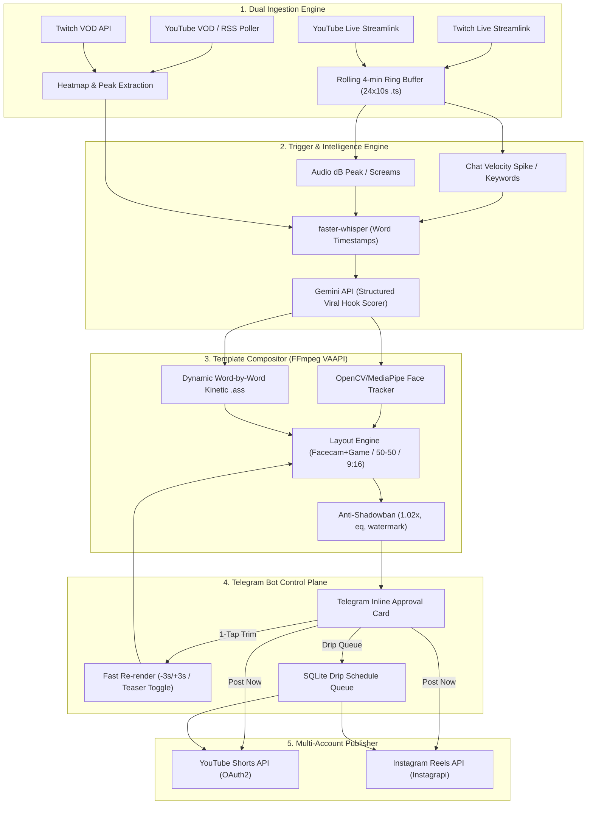

# Project Specification: Automated Live & VOD Social Media Clipping Engine ("AutoClipDaemon")

## 1. Project Overview & Core Objective
**AutoClipDaemon** is a modular, production-ready, autonomous Python clipping pipeline controlled entirely via a **Telegram Bot**. 

The system continuously monitors specified YouTube and Twitch channels (both **ongoing live streams** and **newly uploaded VODs**), automatically detects high-retention viral moments, cuts and reframes them into 9:16 vertical videos using customizable **Creator Templates** (e.g., IShowSpeed gaming layout vs. 2-person podcast layout), burns in dynamic word-by-word kinetic `.ass` subtitles, sends the rendered clip to Telegram for **1-tap mobile approval/trimming**, and automatically publishes approved clips to **YouTube Shorts** and **Instagram Reels** with multi-account routing.



---

## 2. Tech Stack & System Environment
- **Operating System & Acceleration:** Linux environment (Ubuntu 22.04+ or Debian 12 recommended) with FFmpeg hardware acceleration (`-hwaccel vaapi`, `h264_vaapi`) and automatic software fallback to `libx264` for maximum portability across cloud nodes and workstations.
- **Language & Runtime:** Python 3.11+ using `asyncio` for concurrent stream ingestion, background rendering queues, and Telegram polling.
- **Database:** `aiosqlite` (asynchronous SQLite3) for zero-latency local state management of monitored creators, processed stream IDs, clip review states, and drip queues.
- **Ingestion & Buffering:**
  - `streamlink`: Live HLS stream pipes with stdout forwarding to FFmpeg segmenters.
  - `yt-dlp`: VOD metadata extraction, YouTube "Most Replayed" heatmap parsing, audio extraction (`-f ba`), and keyframe-accurate slice extraction (`--download-sections`).
- **Audio & Transcription:**
  - `faster-whisper`: High-performance CTranslate2 Whisper implementation with `word_timestamps=True`.
  - `astats` & `silencedetect`: Real-time audio dB peak and silence detection.
- **Computer Vision & Spatial Tracking:**
  - `opencv-python` / `mediapipe`: Face detection, dynamic active-speaker bounding box computation, and rolling-average spatial smoothing.
- **AI Hook & Transcript Virality:**
  - `google-genai` / Gemini API with structured JSON outputs and Pydantic validation for high-retention segment discovery.
- **Telegram Control Plane:**
  - `aiogram` (v3.x): Modern asynchronous Telegram bot framework handling command routing, inline query keyboards, and interactive media updates.
- **Publishing & Social Routing:**
  - `google-api-python-client` & `google-auth-oauthlib`: YouTube Data API v3 for YouTube Shorts upload.
  - `instagrapi`: Instagram Private API client with session reuse, challenge handling, and Reels distribution.

---

## 3. Directory & Modular Architecture
```text
autoclip-daemon/
├── config/
│   ├── .env.example              # Environment variables template
│   ├── settings.py               # Central configuration & path manager
│   └── tokens/                   # Persistent OAuth2 and session tokens
├── templates/
│   ├── ishowspeed_gaming.json    # Facecam top + Gameplay bottom, bold yellow/red captions
│   ├── podcast_split.json        # 50/50 split-screen or active speaker crop, clean captions
│   └── irl_streamer.json         # Full 9:16 dynamic face-tracked crop
├── assets/
│   ├── fonts/                    # Montserrat-ExtraBold.ttf, TheBoldFont.ttf
│   ├── watermarks/               # Per-channel transparent PNG logos
│   └── sfx/                      # Camera flash, whoosh risers, subtle background tracks
├── src/
│   ├── database.py               # Async SQLite schema & CRUD operations
│   ├── monitor/
│   │   ├── live_watcher.py       # Streamlink HLS ring-buffer + Chat velocity + Audio dB detector
│   │   └── vod_watcher.py        # RSS/API poller + yt-dlp heatmap & audio-first extractor
│   ├── intelligence/
│   │   ├── transcriber.py        # faster-whisper word-level timestamp generator
│   │   └── viral_scorer.py       # Gemini structured output hook/clip selector
│   ├── compositor/
│   │   ├── face_tracker.py       # OpenCV/MediaPipe face crop coordinate calculator
│   │   ├── ass_generator.py      # Word-by-word karaoke/pop-in .ass subtitle builder
│   │   └── ffmpeg_renderer.py    # Template-driven FFmpeg filter_complex builder + anti-shadowban
│   ├── bot/
│   │   ├── telegram_bot.py       # Aiogram commands (/add, /templates, /queue) & approval callbacks
│   │   └── trimmer.py            # Fast re-render handler when user taps -3s/+3s on Telegram
│   └── publisher/
│       ├── youtube_shorts.py     # Multi-account OAuth2 YouTube Shorts uploader
│       ├── instagram_reels.py    # Multi-account Instagram Reels uploader
│       └── scheduler.py          # Drip-feed queue worker (spaces posts out by X hours)
├── main.py                       # Async entrypoint launching Bot + Monitor Workers + Scheduler
├── requirements.txt              # Production dependency specifications
├── PROJECT_SPEC.md               # Detailed specification
└── README.md                     # Comprehensive operations guide
```

---

## 4. Core Functional Modules

### Module A: Dual Ingestion Engine (Live Streams + VODs)
#### 1. Live Stream Ring Buffer (`src/monitor/live_watcher.py`)
- Continuously polls Twitch Helix API / Twitch GraphQL and YouTube Live endpoints to identify when tracked creators begin broadcasting.
- Spawns a streaming pipeline via `streamlink --stdout <stream_url> best` piped directly into:
  ```bash
  ffmpeg -i - -c copy -f segment -segment_time 10 -segment_wrap 24 -reset_timestamps 1 /tmp/live_buffer/<channel>/chunk_%03d.ts
  ```
  This guarantees a zero-latency, rolling 4-minute FIFO buffer on disk consuming minimal disk space.
- Runs concurrent trigger detectors:
  - **Chat Velocity Spike:** Connects to Twitch IRC (`irc.chat.twitch.tv:6667`) or YouTube Live Chat. Tracks a rolling 60-second baseline of messages per second (MPS). Triggers whenever the 5-second MPS exceeds `baseline * template.chat_spike_multiplier` or contains configured hype keywords (`CLIP IT`, `WTF`, `LMAO`, `W SPEED`).
  - **Audio Peak Detector:** Analyzes incoming chunks using FFmpeg `astats` or RMS energy calculations to spot sudden screams, explosions, or dramatic laughing fits.
- Upon trigger detection, waits 20 seconds for the event to conclude, concatenates the surrounding 75 seconds of `.ts` chunks into a single intermediate `.mp4`, and transfers it to the Intelligence Pipeline.

#### 2. VOD Poller (`src/monitor/vod_watcher.py`)
- Monitors YouTube RSS feeds (`https://www.youtube.com/feeds/videos.xml?channel_id=...`) and Twitch Past Broadcasts.
- Uses `yt-dlp --write-info-json --skip-download` to extract the YouTube "Most Replayed" heatmap data array.
- Flags segments where the retention score exceeds `0.75`.
- Performs an audio-first download (`yt-dlp -f ba`) for fast transcription, and selectively downloads high-resolution video segments only for AI-selected timestamps using `--download-sections "*start-end" --force-keyframes-at-cuts`.

---

### Module B: AI Viral Hook & Transcript Engine (`src/intelligence/`)
- **Transcription (`transcriber.py`):** Runs `faster-whisper` with `word_timestamps=True` on the candidate audio. Extracts precise timing tuples `(word, start_time, end_time, confidence)`.
- **Viral Hook Scoring (`viral_scorer.py`):** Sends transcript intervals alongside chat velocity and audio peak metadata to Gemini using structured Pydantic schemas.
- Filters for:
  1. Duration: 25 to 58 seconds.
  2. Opening Hook: High-tension curiosity gap within the first 3 seconds.
  3. Resolution: Satisfying punchline or emotional climax.
  4. Returns: `start_time`, `end_time`, `teaser_hook_timestamp`, `virality_score` (0-100), `suggested_title`, and `hashtags`.
  5. Segments below `template.min_virality_score` are dropped immediately.

---

### Module C: Creator Template System (`templates/*.json`)
Templates define exact visual layouts, typography, caption animations, pacing rules, and target social accounts:

1. **`layout.type`:**
   - `"facecam_top_gameplay_bottom"`: Crops creator facecam to top 38% (1080x730), gameplay to bottom 62% (1080x1190), stacked vertically.
   - `"split_screen_50_50"`: Dual speaker layout with two 1080x960 regions stacked vertically.
   - `"dynamic_face_track"`: Single 9:16 crop smoothly centered on the active speaker using rolling-average coordinates.
   - `"blurred_bg_center"`: 16:9 foreground layered over a 1080x1920 heavily blurred background.

2. **`subtitles`:**
   - Word-by-word kinetic `.ass` generation.
   - Pop-in scale animation: `{\t(0,70,\fscx118\fscy118)}`.
   - Karaoke active-word color change in `&HBBGGRR&` hex.
   - Positioned on safe vertical margins (e.g., $Y=730$ directly on the split-screen dividing line).

3. **`pacing` & `anti_shadowban`:**
   - `strip_silences`: Removes pauses longer than 350ms.
   - `teaser_preroll`: Cuts a 1.5-second climax teaser, prepends it at 00:00 with a flash transition.
   - Speed adjustment: `1.02x` via `setpts=PTS/1.02` and `atempo=1.02`.
   - Video grading: `eq=contrast=1.03:saturation=1.05`.
   - Background audio: Subtle tension riser or backing track mixed at -26dB.

4. **`destinations`:**
   - Direct mapping to account keys:
     ```json
     "destinations": {
       "youtube_account_key": "speed_yt",
       "instagram_account_key": "speed_ig"
     }
     ```

---

### Module D: Telegram Command & 1-Tap Approval Bot (`src/bot/`)
Restricted to `ADMIN_CHAT_ID` with inline query keyboards:

- **Commands:**
  - `/add <platform> <channel_id_or_handle> <template_name>`
  - `/remove <channel_id_or_handle>`
  - `/clip <video_url> <template_name> [optional_start-end]`
  - `/templates`
  - `/queue`

- **Interactive Approval Card:**
  - Displays rendered MP4 video, creator, template, virality score, and proposed caption.
  - Buttons:
    - `[✅ Post Now (YT + IG)]`: Parallel immediate publishing.
    - `[🗓️ Add to Drip Queue]`: Enqueues to drip scheduler.
    - `[⏪ -3s Start]` `[⏩ +3s Start]`
    - `[⏪ -3s End]` `[⏩ +3s End]`
    - `[🎬 Toggle Teaser Hook]`
    - `[❌ Discard]`
  - **Reply-to-Edit Caption:** Replying to the video message updates the title and caption in SQLite.

---

### Module E: Multi-Account Auto-Publisher & Drip Scheduler (`src/publisher/`)
- **YouTube Shorts (`youtube_shorts.py`):**
  - Resumable uploads via YouTube Data API v3.
  - Adds `#Shorts` and template hashtags.
  - Uses OAuth2 refresh tokens stored per account key.
- **Instagram Reels (`instagram_reels.py`):**
  - Uploads vertical MP4 to Instagram Reels via `instagrapi`.
  - Automatic session reload and checkpoint verification.
- **Drip Scheduler (`scheduler.py`):**
  - Background async worker scanning `scheduled_queue` every 60 seconds.
  - Spaces uploads by configured drip interval (e.g. 4 hours) to prevent algorithmic spam penalties.

